<picture>
  <source media="(prefers-color-scheme: dark)" srcset="assets/header-dark.svg">
  
</picture>

For six years I've built software end to end, from the Postgres schema to the screen a customer taps, and stayed for the part after launch. Most of it is multi-tenant SaaS for Turkish businesses, where KVKK, consent records and local payment providers are part of the spec, not a cleanup task. In between, I write small tools for the problems I keep running into along the way.

**[mustafabaser.net](https://mustafabaser.net)** · [Portfolio](https://mustafabaser.net/portfolio) · [Blog](https://mustafabaser.net/blog) · [LinkedIn](https://linkedin.com/in/mustafabaser) · [X](https://x.com/mustafakbaser) · [Medium](https://mustafakbaser.medium.com/) · [info@mustafabaser.net](mailto:info@mustafabaser.net)

## Open source

Each of these started as a question I got tired of answering by hand.

**[agentcheckup](https://github.com/mustafakbaser/agentcheckup)**: Claude Code, Codex, Cursor and Copilot read different files from the same repository, and rarely say what they skipped. This shows what each one actually loads, and flags the MCP servers, hooks and permissions a pull request adds. `npx agentcheckup` · [npm](https://www.npmjs.com/package/agentcheckup) · [GitHub Action](https://github.com/marketplace/actions/agentcheckup)

**[Field Guide](https://github.com/mustafakbaser/field-guide)**: an architecture map that can't go stale, because it is derived from the import graph and commit history every time you ask. What depends on what, what changes together, and who knows the part you are about to touch. VS Code extension and MCP server · [Marketplace](https://marketplace.visualstudio.com/items?itemName=mkbaser.fieldguide)

**[Port Authority](https://github.com/mustafakbaser/port-authority)**: something is already listening on port 3000. This tells you what it is, which project started it, and stops it safely. VS Code extension · [Marketplace](https://marketplace.visualstudio.com/items?itemName=mkbaser.port-authority)

**[claude-commit-skill](https://github.com/mustafakbaser/claude-commit-skill)**: `/commit` for Claude Code that follows your repository's convention and refuses the commits you can't take back, like one made mid-merge or one carrying a secret. `npx claude-commit-skill` · [npm](https://www.npmjs.com/package/claude-commit-skill)

## Selected work

**[HeyPilot](https://mustafabaser.net/portfolio/heypilot)**: multi-tenant voice AI for customer service, outreach and appointments, with a no-code assistant builder, white-label widgets, a KVKK encryption layer and IYS-ready consent capture. Live at [heypilot.com.tr](https://heypilot.com.tr). Next.js 15 · Turborepo · Prisma · PostgreSQL · Redis · VAPI · OpenAI · Claude · ElevenLabs · Deepgram

**[LayeredMindAI](https://mustafabaser.net/portfolio/layeredmind-ai)**: multi-provider AI chat with Turkish market data and multi-organization RBAC, plus a [Flutter app](https://mustafabaser.net/portfolio/layeredmind-ai-mobile) for iOS and Android. React · Node.js · Express · MongoDB · Flutter · Riverpod

**[Broker Desk](https://mustafabaser.net/portfolio/brokers-desk)**: RSS in, publishable posts out. Financial news is enriched with LLMs, given branded visuals and sent to email and X from one analyst dashboard. Next.js 16 · React 19 · TypeScript · Tailwind CSS 4

**[StitchAI](https://mustafabaser.net/portfolio/stitchai)**: takes a frame from an industrial camera, segments it with Segment Anything, generates a toolpath and drives a CNC machine over Modbus. Python · PyQt6 · OpenCV · PyTorch

More work

 

- **[Relio](https://mustafabaser.net/portfolio/relio)**: clipboard manager for macOS that encrypts everything on-device and expires API keys and card numbers on its own. Swift 6, SwiftUI.
- **Novadesk CRM**: back office for virtual office and coworking providers. Contracts, billing, room bookings, KVKK-aware data handling.
- **KYC and document OCR**: merchant onboarding for a Turkish payment processor. Identity OCR, tax document extraction, IBAN validation, a review queue.
- **[EpicTales](https://play.google.com/store/apps/details?id=com.mustafakbaser.epictales)**: Android app that writes age-appropriate children's stories with Gemini and reads them aloud in nine languages. On Google Play.
- **[Currency Converter](https://play.google.com/store/apps/details?id=net.mustafabaser.dkscurrencyconversion)**: live exchange rates in Kotlin and Jetpack Compose. On Google Play.

The full list, with stacks and screenshots, is in the [portfolio](https://mustafabaser.net/portfolio).

## How I work

- **Derive, don't document.** An architecture diagram starts going stale the day it is drawn. The import graph and the commit history can't.
- **Identify before you act.** Killing the process is the easy part. The work is finding out whose process it is.
- **Coverage isn't correctness.** Coverage tells you a line ran, not that it was right. A test earns its place by what it tells you when it breaks.
- **Make it reversible.** Every migration ships with its rollback, and good tools refuse what can't be undone.

## Writing

Mostly in Turkish, on [mustafabaser.net/blog](https://mustafabaser.net/blog).

<!-- BLOG-POST-LIST:START -->
- [Testler Yeşil ama Prod Yanıyor: Test Kalitesi Rehberi](https://mustafabaser.net/blog/test-kalitesi-rehberi) Jul 2026
- [Building an Intelligent Commit Skill for Claude Code](https://mustafabaser.net/blog/building-intelligent-commit-skill-for-claude-code) Feb 2026
- [4Ls Retrospective: Sprint Retrospektiflerini Daha Değerli Hale Getirmek](https://mustafabaser.net/blog/4ls-retrospective-rehberi) Jan 2026
- [Port Zaten Kullanımda Hatası: Portu Bulma ve Güvenle Kapatma](https://mustafabaser.net/blog/port-zaten-kullanimda-hatasi-portu-bulma-ve-kapatma) Sep 2025
- [Docker Temelleri: Temelden Gerçek Proje Kullanımına](https://mustafabaser.net/blog/docker-temelleri-temelden-gercek-proje-kullanimina) Mar 2025

<!-- BLOG-POST-LIST:END -->

## Stack

Day to day: **TypeScript, Next.js, Node.js, PostgreSQL and Supabase, Docker.**

Everything else I've shipped with

 

| Area | Tools |
| --- | --- |
| Languages | TypeScript, JavaScript, Java, Kotlin, Python, C#, Go, Swift, Dart |
| Backend | NestJS, Express, Fastify, Spring Boot, ASP.NET Core, Django, Flask, REST, GraphQL, OpenAPI |
| Frontend | React, Next.js, Vue.js, Tailwind CSS, Radix UI, TanStack Query |
| Mobile and desktop | Android (Kotlin, Jetpack Compose), Flutter, SwiftUI, PyQt |
| Data | PostgreSQL, Supabase, MySQL, SQL Server, Oracle, MongoDB, Redis, Prisma, TypeORM, Hibernate/JPA |
| AI | LLM integration across providers, MCP servers, voice agents, Gemini, OpenCV, Segment Anything |
| Infrastructure | Docker, Kubernetes, Terraform, GitHub Actions, Jenkins, AWS, GCP, Vercel, Nginx, PM2, Linux |
| Testing | Jest, Playwright, JUnit, Mockito, Pytest |
| Integrations | Stripe, Iyzico, Salesforce, n8n |
| Architecture | Domain-Driven Design, Clean Architecture, modular monoliths, microservices, multi-tenant SaaS |

## Work with me

Open to freelance and contract work, from a first schema to a production launch. Write to [info@mustafabaser.net](mailto:info@mustafabaser.net) or find me on [LinkedIn](https://linkedin.com/in/mustafabaser).

If one of these tools saved you some time, you can [buy me a coffee](https://buymeacoffee.com/mustafakbaser).
